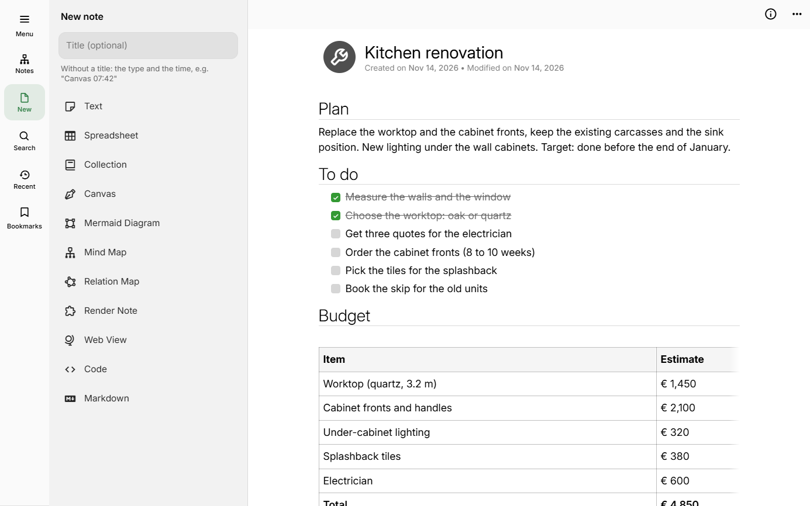

# Trilium tablet UI

A custom theme (`#appCss`) and widget (`#widget`) that adapt [Trilium Notes](https://github.com/TriliumNext/Trilium)'
mobile layout to a tablet. It was made and tested on an 11-inch Android tablet (1385 × 866 dp in landscape) with the
official Android app and the mobile web frontend. Every rule applies only to the mobile layout on screens of 700 dp
or more, so phones and the desktop layout are unchanged.

| Text note, note tree open | Canvas note, tool options |
|---|---|
|  |  |
| **Menu as a side panel** | **New note: choose the type** |
|  |  |
| **Calendar collection: one top bar** | **Portrait** |
|  |  |

## What it changes

- **Landscape: a navigation rail** on the left with a label under each launcher; Sync at the bottom.
- **Docked side panels.** On the left: Menu, the note tree, Bookmarks, the note types of "New" or the quick search,
  one at a time. On the right: the note's "…" menu, the note panel (outline, attributes, connections) or the canvas
  tool options. The note area shrinks instead of being covered, and the panels start below the system status bar.
- **Menu:** one column of equal rows, in groups like a settings list.
- **Note tree:** the top bar names the folder you are in ("‹" goes up a level); the open note is highlighted; the tree
  closes when a note is chosen in it or the open note is tapped.
- **New** asks for the note type first, with an optional title; without one the note is named after its type and the
  time ("Canvas 07:42"), so the tree does not fill up with notes called "New note". **Search** opens the quick search
  in the left panel, with results as you type, instead of replacing the open note with a search note.
- **Collections:** the collection's bar (view type, settings, calendar navigation) joins the title row when it fits.
- **Text notes:** a reading column of about 720 dp, a compact formatting toolbar docked to the bottom edge and, in
  landscape, the outline of the headings in the free space on the right (from three headings).
- **Canvas notes (Excalidraw):**
  - zoom (one button with the level: zoom in, zoom out, fit to drawing, 100%), undo/redo, pen mode, the "keep the tool
    active" padlock, tool options and full-screen drawing sit in the note's top bar; the tool bar is compact, centred
    and docked to the bottom edge;
  - rectangle, diamond and ellipse share one **Shapes** button: a tap picks the last shape used, a second tap shows
    the three; Excalidraw's "More tools" menu (frame, web embed, laser pointer, Mermaid) opens above the tool bar;
  - the padlock is on in every canvas, so the tool stays active after a shape or a frame (open it by hand to go back
    to the pointer after each shape);
  - tool options open in the right panel with a button; tapping a tool only changes the tool;
  - stroke width is a continuous slider; Stroke and Background get a row of your own colours (add, apply, remove,
    and Excalidraw's five can be removed too);
  - a "Pen pressure" slider stretches the pen's pressure, so light and firm strokes differ more; holding the pen's
    side button erases while it touches;
  - in pen mode one finger moves the sheet; the drawing stays in place when a side panel opens;
  - images in canvases load in the Android app too (its requests repeat the image's `Content-Type` header, and the
    data URL built from it did not decode).
- **Touch details:** a long press on an icon button shows its name (hover tooltips never appear on a touch screen);
  the note panel button has an info icon; no grey "hover" left on the last button touched; pen taps that the WebView
  ends without a click are completed.

## Install

1. Create a **code note** of type CSS, paste [`tablet_ui.css`](tablet_ui.css) and add the label `#appCss`.
2. Create a **code note** of type JavaScript (frontend), paste [`tablet_ui.js`](tablet_ui.js) and add the label
   `#widget`.
3. Optional, the **Notes** button of the rail: create a frontend JavaScript note with
   [`tablet_ui_notes_toggle.js`](tablet_ui_notes_toggle.js). Then, in the mobile launch bar configuration
   (Menu → Configure launch bar), add a *script launcher*, set its `script` relation to that note, its title to
   "Notes" and its icon to `bx bx-sitemap`, and move it to the top of the visible launchers.
4. Restart the app (or reload the page).

To turn it off, rename the labels to `#disabled:appCss` and `#disabled:widget` and restart.

## Notes

- Tested with Trilium 0.107 (nightly builds of November 2026), theme-next and the classic Light theme.
- It relies on Trilium's and Excalidraw's DOM structure and class names, so an update can break parts of it.
- Excalidraw's API is private to Trilium's canvas widget; the canvas features reach the Excalidraw instance through
  Preact's base component class. In Trilium's own code they would use the API directly.
- Your colours and the pen pressure level are stored in the device's local storage.

Upstream discussion: [TriliumNext/Trilium#12609](https://github.com/TriliumNext/Trilium/issues/12609) (feature
request) and [#12610](https://github.com/TriliumNext/Trilium/pull/12610) (draft pull request for the navigation rail
and docked panels).

## License

[GNU Affero General Public License v3.0](LICENSE) or later, the same licence as Trilium.
